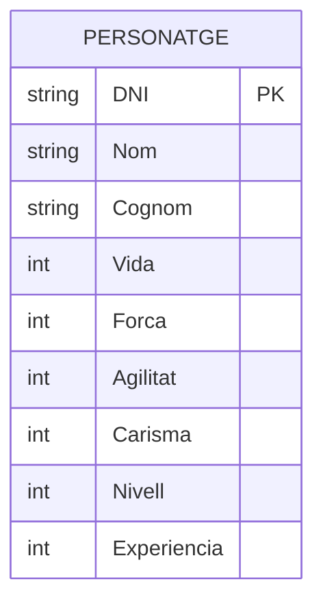
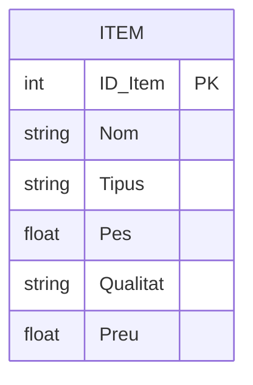
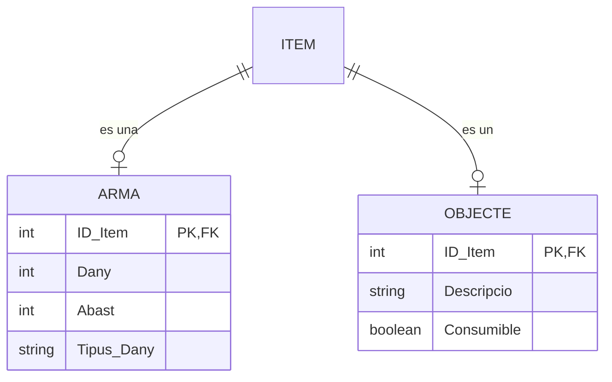
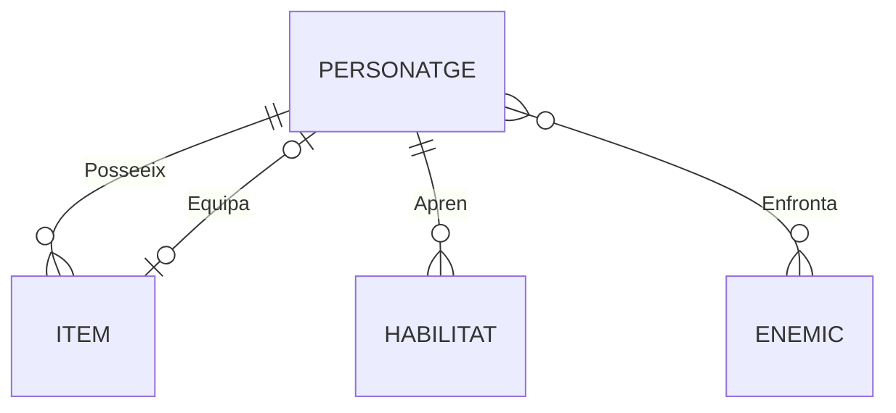
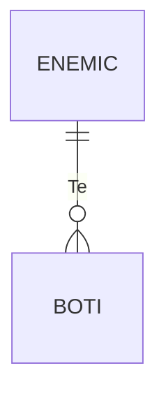
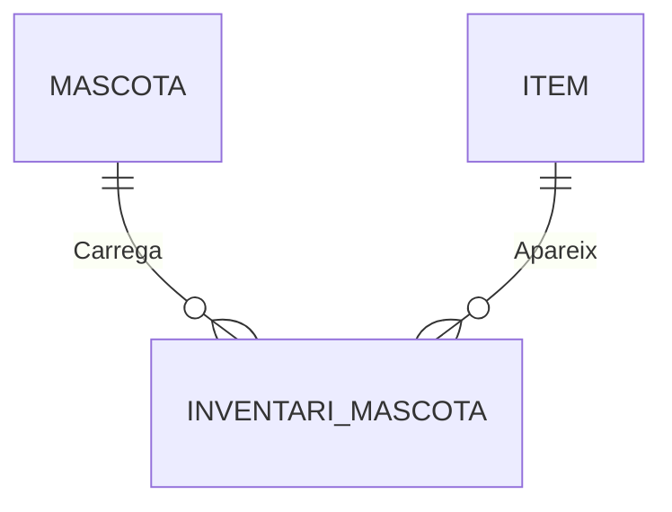
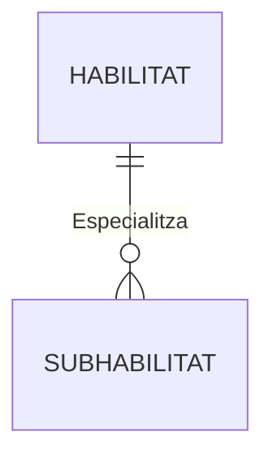
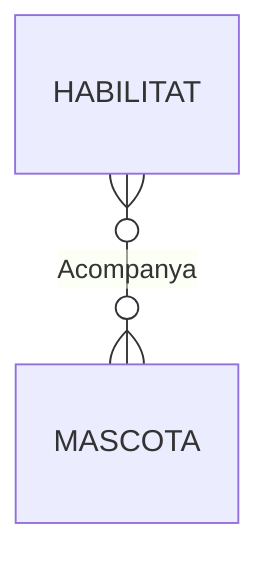
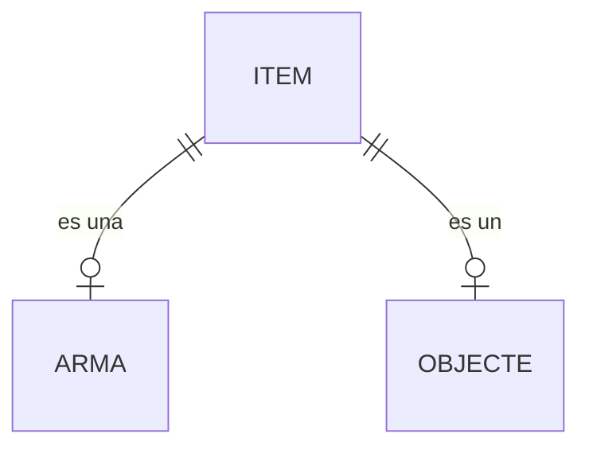
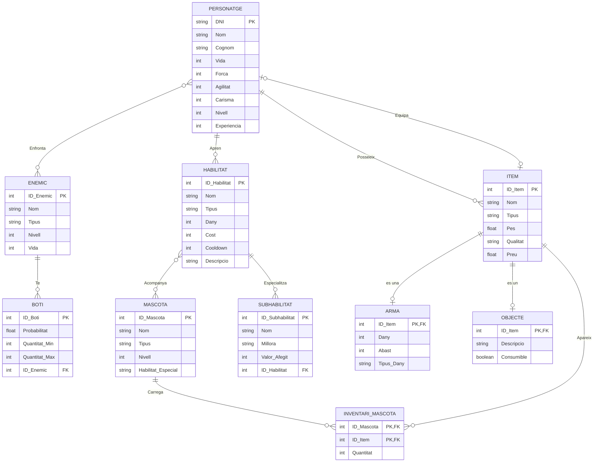

# Diagrama E/R amb Mermaid: videojoc

## 1. Introducció

L'objectiu d'aquesta activitat és transformar el disseny conceptual d'un videojoc en un diagrama Entitat/Relació (E/R) mitjançant Markdown i Mermaid.

El model representa els personatges, els objectes, les armes, les habilitats, les subhabilitats, els enemics, els botins i les mascotes. També representa les relacions entre aquestes entitats i les cardinalitats corresponents.

El diagrama E/R permet visualitzar l'estructura de les dades abans de crear les taules d'una base de dades relacional.

## 2. Identificació de les entitats

A partir del disseny conceptual, s'han identificat les entitats següents:

- **PERSONATGE:** representa el jugador principal del videojoc.
- **ITEM:** representa els objectes generals que es poden posseir o equipar.
- **ARMA:** representa els items que es poden utilitzar per atacar.
- **OBJECTE:** representa els objectes consumibles o especials.
- **HABILITAT:** representa les habilitats que poden aprendre els personatges.
- **SUBHABILITAT:** representa les millores o especialitzacions d'una habilitat.
- **ENEMIC:** representa els enemics del videojoc.
- **BOTI:** representa les recompenses que poden deixar els enemics.
- **MASCOTA:** representa les criatures que acompanyen els personatges.
- **INVENTARI_MASCOTA:** representa els items que transporta cada mascota.

En Mermaid, les entitats s'escriuen dins d'un bloc `erDiagram`. Els seus atributs es defineixen entre claus `{}`.

### Exemple de representació d'una entitat

L'entitat PERSONATGE conté els atributs que descriuen el personatge. L'atribut `DNI` és la clau primària (`PK`), perquè identifica de manera única cada personatge.

## 3. Definició dels atributs i les claus

Cada entitat conté els atributs necessaris per representar les seves propietats. Els tipus de dades indiquen quina classe de valors es poden emmagatzemar.

Les claus primàries s'identifiquen amb `PK` i les claus foranes amb `FK`.

### Exemple de clau primària

En aquest exemple, `ID_Item` identifica de manera única cada item.

Les entitats ARMA i OBJECTE són especialitzacions d'ITEM. Com que Mermaid no disposa d'una notació específica d'herència dins d'`erDiagram`, aquesta especialització es representa mitjançant una relació d'identificació d'un a un.

`ID_Item` és alhora clau primària i clau forana en ARMA i OBJECTE. Això permet que cada arma o objecte especialitzat correspongui a un registre de l'entitat ITEM.

## 4. Representació de les relacions i les cardinalitats

Les relacions indiquen com s'associen les entitats. Cada relació s'escriu amb una línia entre les entitats i una etiqueta descriptiva.

Els símbols de cardinalitat utilitzats en Mermaid són:

| Símbol | Significat |
|---|---|
| `||` | Exactament un |
| `o|` | Zero o un |
| `o{` | Zero o molts |
| `|{` | Un o molts |
| `}o` | Molts, amb participació opcional |

### 4.1. Relacions del personatge

Un personatge pot posseir diversos items, equipar com a màxim un item, aprendre habilitats i enfrontar-se a enemics.

La relació POSSEEIX indica que un personatge pot tenir diversos items. La relació EQUIPA representa que un personatge pot no tenir cap item equipat o tenir-ne un com a màxim.

La relació APREN representa les habilitats del personatge. La relació ENFRONTA és de molts a molts (`M:N`), ja que un personatge pot enfrontar-se a diferents enemics i un enemic pot enfrontar-se a diferents personatges.

### 4.2. Relació entre enemics i botins

Els enemics poden deixar botins quan són derrotats. Cada botí queda associat a un enemic.

Aquesta relació indica que un enemic pot tenir zero o molts botins, mentre que cada botí està associat a un únic enemic.

Per representar aquesta relació en el model de dades, l'entitat BOTI incorpora l'atribut `ID_Enemic` com a clau forana.

### 4.3. Relació entre mascotes i inventari

Les mascotes poden transportar diferents items. Per representar els objectes que porta cada mascota, s'utilitza l'entitat associativa INVENTARI_MASCOTA.

Aquesta entitat associativa conté `ID_Mascota`, `ID_Item` i `Quantitat`. La clau primària està formada per `ID_Mascota` i `ID_Item`, perquè cada item es registra una vegada per mascota, amb la seva quantitat corresponent.

Aquesta estructura permet que una mascota transporti molts items i que un mateix tipus d'item aparegui en els inventaris de diferents mascotes.

### 4.4. Relació entre habilitats i subhabilitats

Les habilitats poden tenir diverses subhabilitats que representen millores o especialitzacions.

Cada subhabilitat està associada a una habilitat. Per representar aquesta associació, SUBHABILITAT incorpora `ID_Habilitat` com a clau forana.

### 4.5. Relació entre habilitats i mascotes

Algunes habilitats poden estar associades a mascotes.

Aquesta relació és de molts a molts: una habilitat pot estar associada a diverses mascotes i una mascota pot estar associada a diverses habilitats.

En una implementació relacional, aquesta relació es podria convertir en una entitat associativa si calgués emmagatzemar les associacions de manera explícita.

## 5. Generalització i especialització

En el disseny conceptual original, ARMA i OBJECTE són subclasses d'ITEM. Això significa que comparteixen els atributs generals de l'item, però també tenen atributs específics.

Mermaid no disposa d'una notació d'herència pròpia per als diagrames E/R. Per això, s'ha representat aquesta especialització mitjançant relacions d'identificació d'un a un, fent servir `ID_Item` com a clau primària i forana de les subclasses.

Aquesta representació permet expressar que una arma o un objecte especialitzat correspon a un item. La cardinalitat opcional indica que no tots els items han de ser armes o objectes.

## 6. Conversió de les relacions molts a molts

Les relacions de molts a molts no es poden implementar directament com una sola clau forana en una base de dades relacional. Normalment, s'han de transformar en entitats associatives.

En aquest model, la relació entre MASCOTA i ITEM ja es representa mitjançant INVENTARI_MASCOTA.

La relació entre PERSONATGE i ENEMIC també és de molts a molts. Si es volgués implementar aquesta relació en una base de dades, es podria crear una entitat associativa COMBAT amb les claus foranes `DNI` i `ID_Enemic`. Aquesta entitat podria incloure altres atributs, com ara la data del combat o el resultat.

En el diagrama final es conserva la relació conceptual directa entre PERSONATGE i ENEMIC, ja que és la que apareix en el disseny original.

## 7. Diagrama E/R final complet

El següent diagrama integra totes les entitats, els seus atributs, les claus primàries i foranes, i les relacions descrites anteriorment.

## 8. Conclusió

Mitjançant Mermaid s'ha transformat el disseny conceptual del videojoc en un diagrama E/R que permet visualitzar les entitats, els atributs, les claus i les relacions.

S'han identificat les claus primàries, s'han incorporat claus foranes per representar les associacions necessàries i s'ha modelat l'inventari de les mascotes amb una entitat associativa. També s'ha representat l'especialització d'ITEM en ARMA i OBJECTE mitjançant relacions d'identificació d'un a un.

Aquest diagrama constitueix una base per a la posterior transformació del model conceptual en un model relacional i per a la implementació de la base de dades del videojoc.
